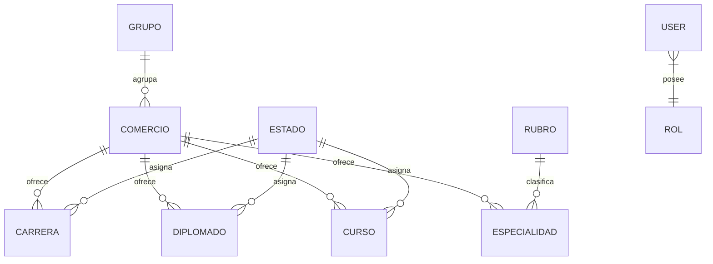

# Contexto General de la Aplicación: Corporación CAPSUR

Este documento proporciona una visión general, resumida y técnica del ecosistema web de **Corporación CAPSUR S.A.C.**, orientado a desarrolladores, administradores y partes interesadas.

---

## 1. Propósito y Definición del Sistema

La aplicación es un **portal institucional y catálogo digital corporativo multimarca con panel de gestión administrativa (CMS)**.

Su objetivo central es unificar, estructurar y difundir la oferta académica y de servicios de las diversas instituciones y marcas que componen el grupo corporativo, facilitando tanto el acceso a información oficial para postulantes y estudiantes, como la administración centralizada para el personal interno.

---

## 2. Objetivos Principales

1. **Centralización Institucional**: Agrupar bajo una misma plataforma las distintas marcas, academias e institutos del grupo (ej. ISTP Avanti, Globalex, Cecava, Certifica SIS, etc.).
2. **Difusión del Catálogo Académico**: Presentar de manera interactiva la oferta formativa organizada en:
   - Carreras profesionales y técnicas.
   - Especialidades.
   - Diplomados.
   - Cursos libres y de actualización.
3. **Transparencia y Respaldo Oficial**: Publicar resoluciones de creación/revalidación, códigos oficiales (ESCALE / MINEDU), mallas curriculares y guías de ingreso a plataformas virtuales.
4. **Gestión Administrativa Simplificada**: Proveer un panel interno seguro para crear, editar y parametrizar programas, sedes, logos, material formativo y canales de atención.

---

## 3. Módulos y Arquitectura Funcional

### A. Portal Público (Front-Office)
- **Directorio de Marcas / Comercios**: Vista clasificada por divisiones corporativas (Grupos) y marcas individuales.
- **Buscador y Filtros**: Búsqueda en tiempo real por término, categoría, grupo y rubro.
- **Fichas Informativas por Institución**: Información legal, enlaces a campus virtuales, verificación de certificados, mallas curriculares y brochures.
- **Acceso a Repositorios Formativos**: Enlaces directos a carpetas institucionales de capacitación (Google Drive).
- **Canales de Atención**: Integración directa con WhatsApp, geolocalización de sede central mediante mapa interactivo, correos y teléfonos.
- **Experiencia de Usuario**: Soporte completo para modo claro (*Light*) y modo oscuro (*Dark*).

### B. Panel Administrativo (Back-Office)
- **Gestión de Estructura Corporativa**: CRUD de Grupos corporativos y Comercios/Marcas.
- **Gestión Académica**: CRUD de Carreras, Especialidades, Diplomados y Cursos (con asignación de tipo, horas lectivas, créditos, estados y enlaces de contenido).
- **Clasificación y Taxonomía**: Mantenimiento de Rubros y Estados de los programas.
- **Gestor de Identidad Visual**: Carga y actualización de logotipos institucionales para temas claro y oscuro.
- **Configuración Global**: Ajuste dinámico de enlaces a capacitaciones (Drive) y datos de contacto oficial.
- **Control de Acceso y Seguridad**: Autenticación segura mediante usuarios, roles, doble factor (2FA) y llaves de acceso (*Passkeys*).

---

## 4. Stack Tecnológico

| Capa | Tecnología / Herramienta | Descripción |
| :--- | :--- | :--- |
| **Backend** | PHP 8.3+ / Laravel 12/13 | Framework MVC principal, Eloquent ORM, migraciones y Laravel Fortify. |
| **Integración Frontend** | Inertia.js (v3) | Conexión monolítica moderna entre Laravel y React sin necesidad de API REST manual. |
| **Frontend** | React 19 + TypeScript | Construcción de interfaces reactivas, modales dinámicos y tipado estricto. |
| **Estilos & UI** | Tailwind CSS (v4) + Material UI (MUI) + Radix UI | Sistema visual híbrido moderno, iconografía avanzada y componentes accesibles. |
| **Base de Datos** | MySQL / MariaDB | Almacenamiento relacional de entidades académicas y configuraciones. |
| **Herramientas de Build** | Vite | Compilación rápida y Hot Module Replacement (HMR). |

---

## 5. Estructura de Datos Central

---

## 6. Perfiles y Actores del Sistema

- **Público General / Alumnos / Postulantes**: Consultan la oferta académica, descargan mallas, acceden a los accesos oficiales de campus y solicitan informes vía WhatsApp.
- **Administrador del Sistema**: Gestiona el catálogo de contenidos, actualiza enlaces a drives, configura parámetros corporativos y administra usuarios autorizados.
